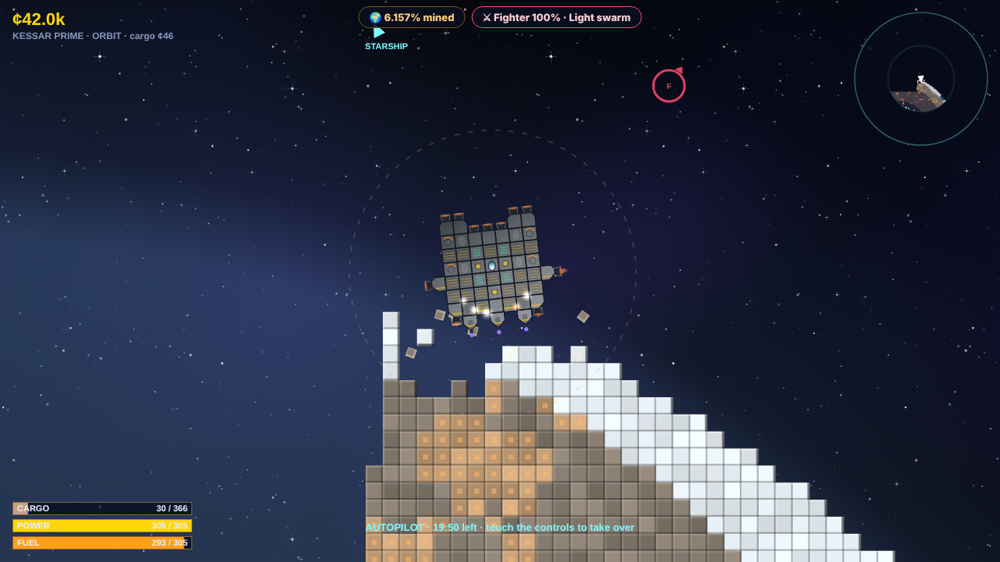

# SPACE FARMER

*One planet. Every last cube of it.*

A browser game about mining an entire planet, one cube at a time. You are the **freighter**: a modular
ship with real 2D rigid-body physics that cuts cubes off a huge layered planet, hauls them home and
sells them. An **autopilot** keeps mining when you put the controls down, for a window you can
upgrade. Out on the picket line your **fighter** holds off endless, escalating swarms of warships. If
it falls, both ships warp home and nothing gets mined until it's repaired. Mine the planet to 100%,
earn Legacy, move on to a bigger one.

HTML5 canvas + vanilla ES modules. No build step, no dependencies, no external assets: all art is
procedural and all audio is synthesized with WebAudio.



## Defaults I picked (instead of asking)

- **How to run:** `node tools/serve.mjs` → <http://localhost:8000> (any static server works; ES modules
  don't load from `file://` in Chromium). It also prints a LAN address for phones. GitHub Pages works as-is
  (there's a `.nojekyll`).
- **The planet is the game.** Planet 1 has ~24k cubes in four layers: Crust, Mantle, Deep Mantle, Core.
  Deeper rock is harder and worth more. Tools come in tiers: the Mining Laser (tier 1) handles Crust and
  Mantle, the Plasma Cutter (tier 2) the Deep Mantle, the Deep Bore (tier 3) the Core. A too-weak tool
  still chips at harder rock, at 4% speed. The surface (ocean, land, ice) is paint over the rock.
- **Taking control isn't faster.** The autopilot flies the same physics as you do. It runs after 5 s
  without input, for an idle window of 2 min at first, up to 4 h with Autopilot Cores. When the window
  runs out it docks. Closing the game counts against the window: offline mining pays 80% of your
  measured rate for min(time away, window).
- **The freighter never takes damage.** The fighter does. It holds station ~2,400 units out on the
  space side of the freighter, so in the freighter view the battle is off-screen. An edge arrow shows
  where it is and its hull, and the top chip shows its status. Click the chip (or **V**) to watch it;
  *Take control* to aim and fire yourself.
- **The swarm** is real-looking warships (interceptors, raiders, gunships, minelayers, frigates) plus
  a capital ship every 4 minutes. It grows the longer a shift lasts, the deeper you've dug and on every
  new planet. When the fighter's hull drops below your retreat threshold (default 30%), it pulls out:
  both ships warp home and repairs take 20 s + up to 100 s depending on damage, at 40% of the normal
  price. You can rush them for credits.
- **Ships look like ships in flight.** The Shipyard shows the blocks. In flight, a hull skin is drawn
  over your layout (Industrial, Military, Sleek, Salvage, or plain Blocks), chosen in the pause menu
  or Log & Settings.
- **Prestige without a reset.** Mining a planet out collapses its core for a payout, gives Legacy points
  (3, 5, 7, …) for permanent perks, unlocks new research and moves you to a bigger, tougher, richer planet.
  Your research and ships carry over. After **3 planets** the campaign is done: planets keep coming
  (Endless), and **Swarm Survival** appears on the title screen.
- **Pacing target:** about 6–8 h of active play for the 3-planet campaign. Measured with the pacing bot
  (below), which plays the real game with a simple cheapest-first strategy and preset ships only. It
  currently takes roughly 3–5 h / 2½–3 h / 3–4½ h. A player who builds their own ships beats it.
- **Fuel** refills (for a small fee) whenever you're home. Run dry and the starship tows you home.
  Hold **R** to warp home any time.
- **Autosave** to `localStorage` every 15 s, on dock, on purchase and when the tab is hidden. Saves from
  the old asteroid version start fresh but keep blueprints and settings.

## Controls

| Flight | | Shipyard | |
|---|---|---|---|
| W / S | thrust forward / reverse | Left click / drag | place part (drag paints) |
| A / D | rotate | Right click / drag | remove part |
| Q / E | strafe | R or mouse wheel | rotate part |
| X (hold) | brake: all thrusters against your drift | M | mirror mode |
| Space | fire mining tools | Middle click | pick up a placed part's type |
| F | dock (near the starship) | Ctrl+Z / Ctrl+Y | undo / redo |
| R (hold) | warp home | Ctrl/⌘ + wheel, − / + | zoom |
| V | watch the fighter (and back) | Arrow keys | pan |
| P | whole-planet view | F / Fit | fit the frame |
| T | flight assist on/off | Enter | launch (from any tab but Shipyard) |
| Wheel | zoom | | |
| M | mute | | |
| F3 | physics telemetry | | |
| Esc | pause (settings, ship skin, quit) | | |

**Watching the fighter:** *Take control*, then A/D aim and Space fires; turrets aim themselves.
**Gamepad:** left stick thrust, right stick turn, RT/A fire, LT brake, LB/RB strafe, B dock.

**iPhone / iPad** (landscape): drag on the left half to fly (point-to-fly), hold FIRE to mine, BRAKE,
DOCK near the starship, hold ⟲ to warp home, ❚❚ to pause. Tap the fighter chip to watch it. Safe areas
(notch, Dynamic Island, home bar) are respected. **Share → Add to Home Screen** runs it fullscreen.

## The loop

1. **Mine.** Cut cubes and they tumble loose. Fly through them (or let the Tractor Coil pull them in).
   Full holds are heavy, and your center of mass shifts as cargo and fuel change.
2. **Go home.** Cargo sells automatically when you reach the starship. **F** docks to upgrade.
3. **Build** in the Shipyard: live stats show mass, thrust-to-weight, turn time, off-center torque vs gyro
   authority, power, fuel, cut speed per layer (cubes/s) and DPS, with warnings for blocked exhausts,
   detached parts, power deficits and ships that *will* spin. Switch to ⚔ Fighter to build the fighter.
4. **Research** (Mining, Automation, Engineering, Defense): prices, mining power, the autopilot window,
   frame size (7×7 up to 31×31), tool tiers, weapons, shields. Some research only unlocks on planet 2 or 3.
5. **Legacy (★):** spend points from mined planets on permanent perks.
6. The **Planet** tab shows the % mined, the layers and their prices, records and the next goal.

## Modes

- **Campaign → Endless:** 3 planets (Kessar Prime, Vorn, Oruleth), then Hallow, Gorvox, and on and on,
  each 1.2× wider, with tougher rock, richer ore and a nastier swarm.
- **Swarm Survival** (after the campaign): your real fighter alone against a swarm that grows 3× faster.
  Play for your best time. Your fighter's damage and your credits are restored afterwards.
- **Sandbox** (title screen): a separate save slot (`spacefarmer.sandbox.v2`) with everything researched,
  ¢1B, cheats (infinite credits/fuel/power, god-mode fighter, no swarm), planet tools (mine 1/5/25% instantly,
  next/previous/fresh planet, set Legacy points) and an in-flight dev bar (spawn any enemy or capital
  ship, kill all, +1 min of swarm, game speed ×0.25–×4).

## Content at a glance

- **Planet:** 9 materials in 4 layers plus 3 tool tiers. 5 planet looks with biomes, clouds, atmosphere
  and day/night.
- **Parts:** Command Core, Hull, Armor, Gyroscope, Reactor, Fusion Reactor (2×2), Battery, Thruster, Torch
  Drive (1×2), Fuel Tank, Cargo Pod, Tractor Coil, Mining Laser, Plasma Cutter, Deep Bore (1×2), Autocannon,
  Railgun (1×2, real recoil), Shield Emitter. Reactors explode, and parts cut off from the core detach.
- **Enemies:** 5 warship types, 4 capital ships with multi-phase attacks (spread, ring, spawn, charge,
  sweeping beam, missiles).
- **Presets:**
  - Freighters: Pebble, Prospector, Excavator, Cutter, Leviathan, Core Borer, Planet Eater, and
    *Lopsided Larry*, a demonstration of off-center thrust.
  - Fighters: Bastion, Bulwark, Citadel, Fortress.
  - Blueprints save, load, export and import as share codes.

## Adding content

**Every number lives in [`js/data.js`](js/data.js)**: materials (`ORES`), planet generation (`PLANETGEN`),
planet looks (`PLANET_THEMES`), parts, enemies, capital ships, swarm escalation (`SWARM`), fighter rules
(`FIGHTER`), autopilot windows (`IDLE`), research (`UPGRADES`), Legacy perks (`LEGACY`), presets, economy
and physics.

**A part:** add an entry to `PARTS`. Behavior comes from its fields, so most parts need no code:

```js
bigCargo: {
  name: 'Cargo Barn', cat: 'utility', role: 'freighter', w: 2, h: 2, mass: 3, cost: 400, hp: 160,
  desc: 'Holds a frankly irresponsible amount of ore.',
  cargo: 100, unlock: 'refinery',          // research id that unlocks it, or null
},
```

Fields include `thrust`, `torque`, `gen`, `battery`, `fuel`, `cargo`, `armor`, `magnet`, `mining` + `tier` +
`laserRange` + `beam` (tools), `weapon {…}`, `shield`, `explode`, `directional`, `muzzle`. Give it an icon
with a `case` in `drawPart()` in [`js/render.js`](js/render.js).

**A material or layer:** add to `ORES` (hp, tier, value, colors) and reference it from `PLANETGEN.layers`.

**A planet look:** add to `PLANET_THEMES`. It needs six biome colors (deep sea, shallows, lowland,
highland, dry, ice), plus sea share, ice-cap size, tilt, atmosphere and cloud colors.

**An enemy:** add to `ENEMIES` with an `ai` (`orbit`, `ram`, `standoff`, `leech`, `mines`, `missiles`), a
budget `cost`, `threat` and `unlockMin` (shift minute it starts appearing). New behaviors go in
`EnemySystem.ai()` in [`js/enemies.js`](js/enemies.js). Capital ships go in `BOSSES` and `SWARM.eliteOrder`.

**Research:** add to `UPGRADES`. `effect` keys are summed by `upgradeEffects()` in
[`js/economy.js`](js/economy.js), and `planet: n` makes it appear from planet n+1. **Legacy perks** go in
`LEGACY`, with `mult` (per-level multipliers) or `add`.

## Tools

```bash
node tools/serve.mjs                 # play at http://localhost:8000 (prints a LAN address too)
node tools/bot.mjs                   # pacing bot: plays the real game headless until 3 planets are mined
node tools/bot.mjs --planets 1       # ...or stop after one planet / --hours 2 / --shot (screenshot at the end)
node tools/check-presets.mjs         # validates every preset and prints its stats
node tools/screenshots.mjs           # key screens at 1280×720, 1920×1080, 1024×768 → docs/screens
```

The bot drives the actual game in headless Chromium, stepping the simulation directly with no rendering
(about 600× real time). The autopilot mines, the fighter fights and the swarm escalates for real. Between
docks it buys the cheapest useful research, spends Legacy points and switches to the best preset ship
that fits. `AP=1 node tools/bot.mjs` also logs what the autopilot is doing. Needs Playwright + Chromium.

## Code map

| File | What it does |
|---|---|
| `js/data.js` | all tunable numbers and content tables |
| `js/planetgrid.js` | the cube planet: generation, layers, biomes, damage, raycasts, chunk/globe rendering, clouds |
| `js/world.js` | the play space: planet, starship, cube pickups, bullets, collisions |
| `js/autopilot.js` | freighter autopilot: target picking, cutting through, docking, watchdog |
| `js/fighter.js` | the escort fighter: picket station, AI aim, retreat and repairs |
| `js/enemies.js` | warship sprites, swarm escalation, AI behaviors, capital ships |
| `js/shipdesign.js` | blueprint grid, placement rules, connectivity, mass/COM/inertia, builder analysis |
| `js/ship.js` | runtime rigid body: thruster allocation, gyro flight assist, power, weapons, damage |
| `js/economy.js` | pure rules: research and Legacy effects, prices, idle window |
| `js/render.js` | part icons, ship sprites and in-flight hull skins, starfield |
| `js/game.js` | state machine, loop, save glue, planet completion, Survival, HUD |
| `js/ui/*` | hangar tabs, builder, research, Legacy, fighter tab, sandbox, tutorial, HUD, touch |
