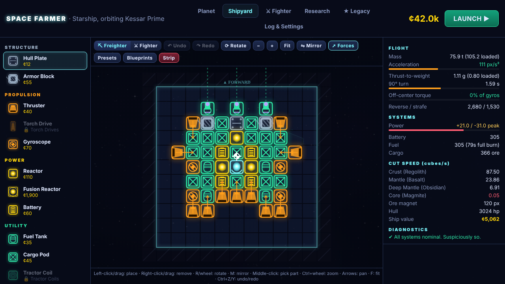

# SPACE FARMER

*Mine rocks. Bolt on guns. Eventually, delete a planet.*

A browser game about building a modular spaceship, flying it with real 2D rigid-body physics, mining
asteroids, fending off pirates, and working your way up to a weapon that destroys planets.
HTML5 canvas + vanilla ES modules. No build step, no dependencies, no external assets: all art is
drawn procedurally and all audio is synthesized with WebAudio.



## Defaults I picked (instead of asking)

- **How to run:** ES modules are blocked on `file://` by Chromium-based browsers, so the game ships
  with a zero-dependency static server: `node tools/serve.mjs` → <http://localhost:8000>. Any static
  server works (`python3 -m http.server`). If you double-click `index.html` in Chrome you get a short
  explanation instead of a black screen. Firefox may run it directly from disk.
- **Parts cost credits when placed and refund when removed**, scaled by the part's condition (so
  removing and re-adding a damaged part is never a free repair). Undo/redo in the Shipyard restores
  both the design *and* the credits.
- **Flight assist is on by default.** It drives gyros to hold or reach the requested spin and fires
  thrusters to cancel drift. It uses the ship's real thrusters and gyros, so a lopsided ship still spins
  when its gyros can't keep up. Press **T** for pure Newtonian flight.
- **Thrusters burn fuel; everything else burns power.** Fuel refills automatically (for a small fee)
  when you dock. Out of fuel you still have weak fuel-free core RCS jets, and you can always hold **R** to
  recall to the outpost.
- **Ship forward is "up" in the builder.** Thrusters push the way they point and need one empty cell
  behind them to vent. Lasers, railguns and the Planet Cracker need a clear cell in front.
- **Death** loses your cargo; insurance rebuilds the Command Core for free and everything else stays
  in the condition it was in (repair at the Market).
- **You choose when to fight.** Each sector has a board of paid **combat contracts** (6 waves, 8 in
  Gorvox). Fly out of the outpost safe zone and press **G** (or click *Start wave* at the top of the
  screen). Each wave pays a fee that grows by ×1.3 per wave, plus bounties, and is rated
  *Easy / Fair / Hard / Deadly* for your current ship. After the last wave you can challenge the sector
  boss. Docking, recalling or dying abandons the contract, but your place on the board is kept.
  Cleared boards can be re-run at 60% pay.
- **Mining is mostly peaceful:** at most 1–2 weak pirates drop by every couple of minutes, and none
  appear inside the safe zone.
- **Sectors** are separate jump destinations, each with its own outpost; harder rocks hold richer ore.
- **Autosave** to `localStorage` every 15 s, on dock, on purchase, and when the tab is hidden.
  **Drone Bay** income keeps accruing while you're away (capped at 4 h).
- **Target pacing** (economy bot, optimal play, fights only Easy/Fair contracts): first boss ≈5 min,
  planet destroyed ≈1h10m. Expect 1.5–2.5 h for a human.
- Desktop first. Gamepad is supported in flight (standard mapping). The builder is mouse-driven.

## Controls

| Flight | | Shipyard | |
|---|---|---|---|
| W / S | thrust forward / reverse | Left click / drag | place part (drag paints) |
| A / D | rotate | Right click / drag | remove part |
| Q / E | strafe | R or mouse wheel | rotate part |
| G | start the next combat contract | | |
| Space | fire mining lasers and railguns (turrets aim and fire themselves) | M | mirror mode |
| F | dock (near the outpost, moving slowly) | Middle click | pick up a placed part's type |
| R (hold) | recall to the outpost | Ctrl+Z / Ctrl+Y | undo / redo |
| C (hold) | charge the Planet Cracker | | |
| T | toggle flight assist | **Hangar** | |
| Wheel | zoom | Enter | launch (from any tab but Shipyard) |
| M | mute | | |
| F3 | physics telemetry | | |
| Esc | pause | | |

**Gamepad:** left stick thrust, right stick turn, RT or A fire, LB/RB strafe, X start contract, Y charge the cracker, B dock.

## The loop

1. **Fly and mine.** Lasers cut rocks; ore chunks fly into your cargo pods. Full pods are heavy pods, and
   your center of mass shifts as cargo and fuel change.
2. **Dock and sell** at the Franchise Outpost (Market tab). Repairs and refueling happen there too.
3. **Build** in the Shipyard. Live stats show mass, thrust-to-weight, 90° turn time, off-center torque
   vs gyro authority, power balance, fuel endurance, mining rate and DPS, with diagnostics that warn
   about blocked exhausts, detached parts, power deficits, and ships that *will* spin.
4. **Research** better prices, mining, health, weapons, part unlocks, bigger frames, and jump licenses.
5. **Take combat contracts (G) when your ship is ready, beat the boss**, and unlock the next sector.
6. **Build a Planet Cracker**, jump to Gorvox, aim at the planet and hold **C**.

The **Road to Doomsday** card in the Market always shows the next step.

## Content at a glance

- **17 parts:** Command Core, Hull Plate, Armor Block, Thruster, Torch Drive (1×2), Gyroscope, Reactor,
  Fusion Reactor (2×2), Battery, Fuel Tank, Cargo Pod, Tractor Coil, Mining Laser, Autocannon, Railgun
  (1×2, real recoil), Shield Emitter, Planet Cracker (3×3). Reactors explode when destroyed, and parts
  cut off from the core detach.
- **6 enemies** with distinct AI: Scrap Gnat (orbit and strafe), Repo Lancer (wind-up ram), Toll
  Collector (standoff bursts), Ore Leech (eats ore pickups and siphons your cargo), Litterbug (mines),
  Complaints Dept. (homing missiles that turrets can shoot down).
- **4 bosses**, each with multiple phases built from spread, ring, spawn, charge, sweeping-beam and
  missile attacks.
- **5 sectors**, a **22-node research tree**, **7 presets** (including *Lopsided Larry*, a demonstration
  of what off-center thrust does), and blueprint save/load/export/import as share codes (`SFBP1:…`).

## Adding content

**Every number lives in [`js/data.js`](js/data.js)**: parts, enemies, bosses, sectors, research, presets,
economy and physics constants.

**A new part:** add an entry to `PARTS`. Behavior comes from its fields, so most parts need no code:

```js
bigCargo: {
  name: 'Cargo Barn', cat: 'utility', w: 2, h: 2, mass: 3, cost: 400, hp: 160,
  desc: 'Holds a frankly irresponsible amount of ore.',
  cargo: 100, unlock: 'refinery',          // research id that unlocks it, or null
},
```

Recognized fields: `thrust`/`fuelUse`/`exhaust`, `torque`/`powerUse`, `gen`, `battery`, `fuel`, `cargo`,
`armor`, `magnet`, `mining`/`laserRange`/`enemyDps`, `weapon {damage, rate, range, speed, energy,
recoil, pierce}` (with `directional: true` for fixed forward guns), `shield`/`shieldRegen`,
`explode {damage, radius}`, `cracker {...}`, `muzzle`, `directional`, `unique`. The category picks the
colour. To give the part its own icon, add a `case` to `drawPart()` in [`js/render.js`](js/render.js); without
one it draws as a coloured plate.

**A new enemy:** add an entry to `ENEMIES` with an `ai` key (`orbit`, `ram`, `standoff`, `leech`,
`mines`, `missiles`), a wave `cost` and a `threat` (estimated damage/s, used for difficulty ratings), then
list it in a sector's `enemies`. A new behavior is one more `case` in `EnemySystem.ai()` in [`js/enemies.js`](js/enemies.js).

**A new boss:** add an entry to `BOSSES` with `phases` (each a list of attacks:
`spread | ring | spawn | charge | beam | missiles`) and set it as a sector's `boss`.

**A new research node:** add an entry to `UPGRADES`. Effects are summed by `upgradeEffects()` in
[`js/economy.js`](js/economy.js); parts reference node ids through `unlock`.

## Tools (self-check)

```bash
node tools/serve.mjs              # play at http://localhost:8000
node tools/bot.mjs                # headless economy bot: timeline of one full playthrough
node tools/bot.mjs --runs 20      # pacing spread across 20 seeded runs
node tools/check-presets.mjs      # validates every preset (connectivity, exhaust, warnings)
node tools/playtest.mjs 300       # real game in headless Chromium, autopilot mines/docks/sells
node tools/playtest.mjs 300 excavator
node tools/screenshots.mjs        # key screens at 1280×720, 1920×1080, 1024×768 → docs/screens
```

`playtest.mjs` and `screenshots.mjs` need Playwright with Chromium installed. The autopilot
([`tools/autopilot.js`](tools/autopilot.js)) flies the real ship through the real physics and
fast-forwards game time. Its measured trip times calibrate the economy bot's model.

## Code map

| File | What it does |
|---|---|
| `js/data.js` | all tunable numbers and content tables |
| `js/shipdesign.js` | blueprint grid, placement rules, connectivity, mass/COM/inertia, builder analysis |
| `js/ship.js` | runtime rigid body: thruster allocation, gyro flight assist, power, weapons, damage, detachment |
| `js/world.js` | sector: asteroids, ore pickups, projectiles, collisions (spatial hash), outpost |
| `js/enemies.js` | contract waves, ambient pirates, AI behaviors, bosses, mines, missiles, beams |
| `js/contracts.js` | contract wave lists, payouts and difficulty ratings (shared with the bot) |
| `js/planet.js` | the planet, cracker charge, destruction cinematic and reward |
| `js/economy.js` | pure rules shared with the bot: prices, research effects, rewards |
| `js/render.js` | procedural part icons, ship sprites, asteroids, starfield |
| `js/particles.js` | pooled struct-of-arrays particles and floating numbers |
| `js/audio.js` | WebAudio synth effects, engine/laser loops, generative music |
| `js/game.js` | state machine, loop, save glue, HUD prompts |
| `js/ui/*` | hangar, builder, research/star map/goals, tutorial, HUD, DOM helpers |
